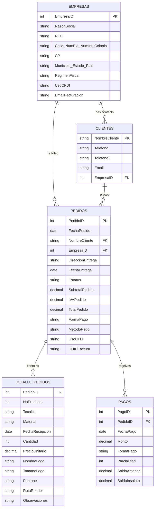

# 🧾 VBA Client & Order Management System

An order management system built in **Excel VBA** for a small promotional-products and garment-printing business in Mexico. It is in daily use by the sales team. It replaced a manual workflow (one large spreadsheet plus Word mail merge) with:

* forms to register, search, edit and delete orders with multiple products,
* a normalized data model (companies, contacts, orders, order lines, payments) stored in Excel sheets and queried with **SQL through ADO**,
* automatic generation of **quotes, work orders, pre-invoices and payment receipts** in Word and PDF,
* input validation for dates, tax IDs (RFC), emails and amounts.

> The repository includes a **demo workbook with fictitious data** (`excel/CALEIDO_Pedidos_demo.xlsm`). No real client data is published.

---

## 🎬 System Demo

The video shows the first version (February 2026): login, order registration, modification and deletion.

[](https://youtu.be/IUj1ImkYP1w)

---

## 🚀 Features

### Orders
* Multi-product orders with technique, material, quantity, unit price, logo size, Pantone, product image and notes.
* Subtotal, VAT (16%) and total per product and per order.
* Search by contact, company or RFC as you type; edit and delete (password-protected) from the same screen.
* Product images are copied next to the workbook and stored as **relative paths**, so the folder can be moved or shared.

### Companies and contacts
* Companies (tax data: legal name, RFC, address by parts, tax regime, CFDI use) are stored separately from contacts; one company can have many contacts.
* Typing part of a company name or RFC shows a dropdown of registered companies and fills in the tax data.
* Contact autocomplete shows "Name - Company"; changed contact data prompts to update the record.
* Companies can be registered without an order, and editing a company updates its contacts.

### Documents (Word automation)
* Templates use `{{FIELD}}` placeholders and a single model block for the product table. VBA repeats the block once per product, inserts the product image and saves `.docx` + `.pdf`.
* Generated documents: **quote**, **work order**, **pre-invoice** (for the accountant, who stamps the CFDI with a PAC) and **payment receipt** (supports full and partial payments, with remaining balance).
* New versions are saved as `_v2`, `_v3` instead of overwriting.
* Amounts are written in words in Spanish (`ImporteConLetra`).

### Data quality
* Delivery and material-reception dates cannot be earlier than the order date; receptions cannot be later than delivery.
* Dates are stored as real dates (`CDate`), not text. Fixes an earlier bug where ADO read text dates as NULL or swapped day and month.
* Amounts are parsed independently of the Windows decimal separator.
* RFC, email and postal code formats are checked with regular expressions; SAT catalogs are used for tax regime, CFDI use and payment method.

---

## 🧠 Architecture

```
UserForms (UI)  →  validation  →  Excel sheets (tables)
                                     │
                    ADO + SQL (ACE OLEDB) ← queries over the same workbook
                                     │
                         Word automation (late binding)  →  .docx / .pdf
```

* **Data layer:** each sheet is a table. `ModuloSQL.EjecutarSQL` opens an ADO connection to the workbook itself (`Microsoft.ACE.OLEDB.12.0`) and returns a disconnected recordset, so lookups and joins are written in SQL instead of loops over cells.
* **UI:** UserForms; the newer forms (`frmEmpresa`, `frmContactos`, `frmFacturar`) create their controls at runtime, so their code is self-contained in the `.frm` file.
* **Documents:** `ModuloWord.GenerarDocumento` fills any template from an order plus optional extra fields (a `Dictionary`), used by the order, pre-invoice and payment flows.
* **No external references:** Word, ADO, regular expressions and WIA are created with `CreateObject`, so the workbook opens on any Windows machine with Office.

### Data model



`Pedidos` and `Clientes` also keep a copy of the company name, RFC and fiscal address at the time of the order, so past documents do not change if a company is edited later. The issuer's tax data is in the `Config` sheet.

---

## 📁 Project Structure

```
.
├── LICENSE
├── README.md
├── docs/
│   ├── manual_ventas.html     # user guide for the sales team (Spanish)
│   ├── manual_ventas.pdf
│   └── system_demo_vba.mp4
├── excel/
│   └── CALEIDO_Pedidos_demo.xlsm   # demo workbook, fictitious data
└── src/                            # exported VBA code (same as in the workbook)
    ├── classes/
    │   ├── clsDiaCalendario.cls     # date picker day buttons
    │   └── clsEventosProducto.cls   # events for dynamically created product controls
    ├── forms/
    │   ├── UserForm1.frm            # order registration and editing
    │   ├── Busqueda.frm             # search
    │   ├── Eliminar.frm             # delete (password)
    │   ├── frmEmpresa.frm           # register / edit company
    │   ├── frmContactos.frm         # search, edit and delete contacts
    │   ├── frmFacturar.frm          # pre-invoice and payment data
    │   ├── frmCalendario.frm
    │   ├── mostrar_imagen.frm
    │   └── Entrada.frm              # login (disabled in the current version)
    └── modules/
        ├── ModuloSQL.bas            # ADO connection and SQL helpers
        ├── ModuloWord.bas           # Word/PDF document generation
        ├── ModuloFacturacion.bas    # pre-invoice, payments, SAT catalogs, amount in words
        ├── ModuloEmpresas.bas       # company lookup and linking
        ├── ModuloClientes.bas       # contact lookup and change detection
        ├── ModuloRegModElim.bas     # save, load and delete orders
        ├── ModuloValidaciones.bas   # field and date validation
        ├── ModuloImagenes.bas       # image copy and loading (PNG/JPG via WIA)
        ├── ModuloCalendario.bas
        ├── Lammado_de_Formularios.bas  # entry points for the sheet buttons
        └── ped_id_creator.bas
```

---

## ⚙️ Installation & Usage

### Prerequisites

* Windows with Microsoft Excel and Word (Office 2016 or later recommended)
* Microsoft ACE OLEDB provider (installed with Office)
* Macros enabled

### Run the demo

```bash
git clone https://github.com/pablo-vc87/vba_client_order_management_system_beta.git
```

1. Open `excel/CALEIDO_Pedidos_demo.xlsm` and enable macros.
2. Use the buttons on the `Comandos` sheet: register order, search / edit / delete, companies, contacts, generate orders, pre-invoice and payment.
3. The demo password for deleting an order is `12345`.

The demo contains 3 fictitious companies, 4 contacts and 3 orders (RFCs, phones and `example.com` emails are made up).

### Word templates

The Word templates (`Plantilla_Orden_Compra.docx`, `Plantilla_Orden_Trabajo.docx`, `Plantilla_Prefactura.docx`, `Plantilla_Complemento_Pago.docx`) carry the client's branding and **are not included**. To generate documents, place your own templates next to the workbook:

* Use placeholders such as `{{PEDIDO}}`, `{{FECHA}}`, `{{RAZON_SOCIAL}}`, `{{DOMICILIO_FISCAL}}`, `{{TOTAL_PEDIDO}}`, `{{TOTAL_LETRA}}`.
* For the product table, write one model block with product fields (`{{TECNICA}}`, `{{DESCRIPCION}}`, `{{CANTIDAD}}`, `{{PRECIO_UNITARIO}}`, `{{TOTAL}}`, `{{RENDER}}`…); it is repeated once per product.
* The full list of fields is in `ModuloWord.Valor` and `ModuloFacturacion`.

Generated files are saved in `ordenes\` and `facturas\` next to the workbook.

### Macro security

If Excel shows a red "Security risk" bar: close Excel, right-click the `.xlsm` → **Properties** → check **Unblock**, and open it again.

---

## 🛠️ Technologies

* Excel VBA (UserForms, class modules, events on runtime-created controls)
* ADO + Microsoft ACE OLEDB (SQL over Excel sheets)
* Word object model (template filling, table row cloning, image insertion, PDF export)
* VBScript regular expressions, WIA (image loading)

---

## 📄 License

This project is licensed under the MIT License.

---

## 📞 Contact

* Author: [Pablo A. V. Calva](https://github.com/pablo-vc87)
* Portfolio: [pablo-vc87.github.io](https://pablo-vc87.github.io)
